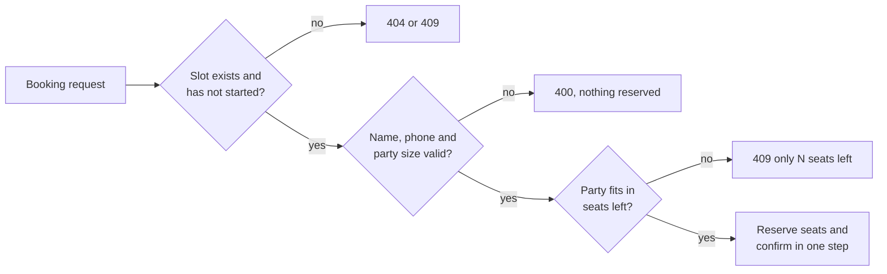

# OkGhumo booking API (prototype)

**[Try the live demo](https://shaazamaan.github.io/okghumo-booking-api/)**: book seats in your browser and watch an overbooking get refused.



## What it does

An operator who runs experiences (a cruise, a trek, a food walk) needs three things from a booking tool:

1. **List an experience**: what it is, where, the price and how long it runs.
2. **Open slots**: the times it runs and how many seats each time has.
3. **Take bookings**: accept a party if it fits, and refuse it if it does not.

This API does those three things. The rule at its centre is that a slot never takes more people
than it has seats. If 2 seats are left and a party of 4 asks, the API answers
`409 only 2 seats left for this slot` and books nothing. An operator who plans for no-shows can
allow a small, explicit overbooking margin per slot.

Built with Node.js (18 or later) and no dependencies. Storage is in memory, so restarting the
server clears the data. This is for demonstrating the flow, not for production.

## How a booking is decided



The live demo page runs the same `src/store.js` that the API server uses.

## Run it

```bash
npm start            # listens on port 3000, or set PORT=3100
npm test             # six tests: booking flow, overbooking, race for last seat, cancellation, validation
```

## Schema

| Table | Fields |
| --- | --- |
| **experiences** | `id`, `operatorId`, `title`, `location`, `pricePaise` (integer, paise), `durationMin` |
| **slots** | `id`, `experienceId`, `startsAt` (ISO 8601, stored in UTC), `capacity`, `overbookBy` (default 0), `booked` (seats taken) |
| **bookings** | `id`, `slotId`, `customerName`, `phone`, `partySize`, `status` (`confirmed` or `cancelled`), `createdAt` |

Seats left for a slot = `capacity + overbookBy - booked`, never below zero.

## Endpoints

| Method | Path | Purpose |
| --- | --- | --- |
| POST | `/experiences` | Create an experience for an operator |
| GET | `/experiences?operatorId=` | List experiences, optionally for one operator |
| POST | `/experiences/:id/slots` | Open a future slot with a capacity |
| GET | `/experiences/:id/slots` | Upcoming slots with `seatsLeft` |
| POST | `/slots/:id/bookings` | Book seats. Returns 409 if the party does not fit |
| GET | `/slots/:id/bookings` | Bookings for one slot (the operator's manifest) |
| POST | `/bookings/:id/cancel` | Cancel a booking and release its seats |

## Sample requests

Create an experience:

```bash
curl -X POST localhost:3000/experiences -H 'Content-Type: application/json' -d '{
  "operatorId": "op_alleppey_01",
  "title": "Backwater sunset cruise",
  "location": "Alappuzha",
  "pricePaise": 150000,
  "durationMin": 120
}'
```

Open a slot with 8 seats (pass the `id` from the previous response):

```bash
curl -X POST localhost:3000/experiences/<EXPERIENCE_ID>/slots -H 'Content-Type: application/json' -d '{
  "startsAt": "2099-12-20T17:00:00+05:30",
  "capacity": 8
}'
```

Book a party of six:

```bash
curl -X POST localhost:3000/slots/<SLOT_ID>/bookings -H 'Content-Type: application/json' -d '{
  "customerName": "Asha Nair",
  "phone": "9800000000",
  "partySize": 6
}'
```

Try to book four more. Only two seats are left, so the API answers with 409:

```json
{"error":"only 2 seats left for this slot"}
```

## Design notes

- **No overbooking by accident.** Each booking checks the seat count and reserves the seats in
  the same step, so two requests cannot both take the last seat. The test suite checks this.
- **Validation before reservation.** A bad request (missing name, zero party size, past slot)
  is rejected before any seat is taken.
- **Cancellation is idempotent.** Cancelling twice returns the same result and frees the seats once.
- **Times are ISO 8601 with an offset.** The API stores them in UTC and returns UTC. Operators in
  Kerala should send `+05:30`, and the UI should display IST.
- **Money is in paise** (integers), so no rounding errors.

## Next steps before this sits behind OkGhumo

1. Replace the in-memory maps with a database. The seat check becomes one conditional update
   inside a transaction, such as `UPDATE slots SET booked = booked + $n WHERE id = $id AND booked + $n <= capacity + overbook_by`.
2. Add operator login. Right now any caller can read or change any operator's experiences.
3. Add payments and a hold timer, so a slot is not held forever while a customer pays.
4. Send confirmations and reminders (WhatsApp or SMS) when a booking is created or cancelled.
5. Add an operator dashboard view over the same endpoints.
6. Agree the field names with OkGhumo's catalogue, so listings map straight across.

## Status

Prototype. Not connected to any OkGhumo system. Not tested with real operators or real bookings.
